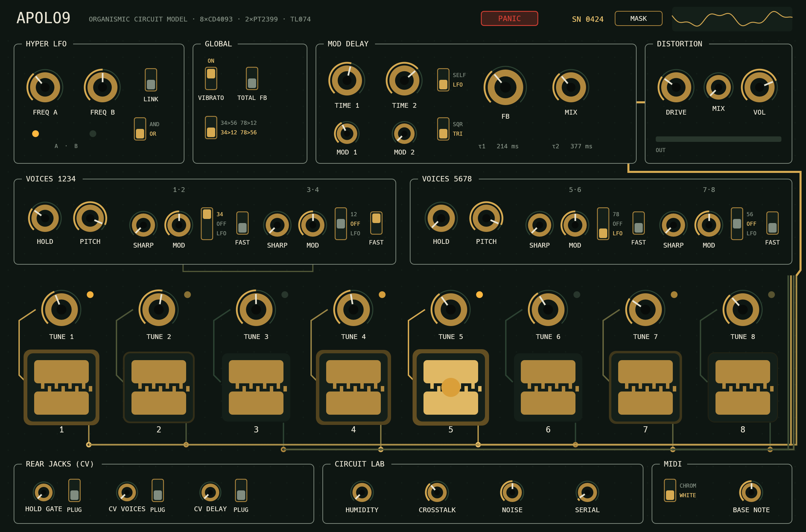

# Apolo9

*An organism with eight voices, rebuilt from its circuit board. It will not do exactly what you ask. Neither did the original.*

AU · VST3 · CLAP · standalone — macOS (Apple Silicon), Windows, Linux.



---

## What is it, exactly?

Apolo9 is a circuit-level model of an **organismic synthesizer**: the kind of experimental,
DIY instrument that tinkerers build from logic chips, touch plates and a soldering iron, on the
principle that an instrument should behave less like a machine and more like a small,
opinionated animal.

It has no oscillators in the polite sense. It has eight CMOS logic gates, abused as
Schmitt triggers, charging and discharging capacitors. It has no envelope generators either,
in the polite sense: it has your finger, closing a circuit through your skin, so the attack
depends on how hard you press, how damp you are and, the manual insists, your emotional state.
The envelopes lean on the oscillators, the oscillators lean on each other through the power
supply, and the whole thing can be told to frequency-modulate itself with its own output.

Apolo9 does not imitate the sound of all that. It simulates the board. Every voice is a
CD4093 gate integrated exactly between threshold crossings, with the real timing capacitors,
the real sensor transistor, the real 10-volt zener. The delay is two PT2399 chips simulated
bit by bit. When the original hums, leaks, drifts, bleeds and locks voices together, Apolo9 does
too, for the same reasons.

It is very good at drones, slow harmony, microtonal melody, rhythmic gurgling, sci-fi weather
and long evenings that started with "I'll just try one thing".

It is not good at playing in tune with anybody. There is no tuning standard on the panel.
There is a knob, and your ear.

---

## Installing

Fetch the archive for your system from
[**Releases**](https://github.com/nagualcode/apolo9/releases/latest).

**macOS (Apple Silicon)**: unzip and run `install.sh`, or copy by hand:

| File | Goes to |
|---|---|
| `Apolo9.component` | `~/Library/Audio/Plug-Ins/Components/` |
| `Apolo9.vst3` | `~/Library/Audio/Plug-Ins/VST3/` |
| `Apolo9.clap` | `~/Library/Audio/Plug-Ins/CLAP/` |

If macOS objects to its foreign origins, run
`xattr -cr ~/Library/Audio/Plug-Ins/Components/Apolo9.component` (and the same for the
others), then restart your DAW. Ableton Live users: rescan, and look under
*Audio Units → Jardim Sonoro*. It is an instrument, so it goes on a MIDI track.

**Windows**: copy `Apolo9.vst3` to `C:\Program Files\Common Files\VST3\` and/or
`Apolo9.clap` to `C:\Program Files\Common Files\CLAP\`.

**Linux**: copy `Apolo9.vst3` to `~/.vst3/` and/or `Apolo9.clap` to `~/.clap/`.

Each archive also holds a standalone application, for those who prefer their organisms
without a host.

---

## First contact (in five minutes)

1. Put Apolo9 on a MIDI track. It opens on **The Organ**, which is step one of the original
   manual: eight voices, tuned to an open A minor, no modulation.
2. Play the white keys from **C3 to C4**. Each one is a sensor. Play softly and the voice
   swells in slowly and only partway; play hard and it opens at once.
3. Let go. The voice fades over several seconds. That is the **slow** release, a 3 MΩ
   resistor taking its time with a 2.2 µF capacitor. Flip a **FAST** switch to make a pair
   less patient.
4. Turn a **TUNE** knob while a voice sounds. There are no notes on it. Find one.
5. Now set the four **MOD SOURCE** switches up (to the numbers) and play two neighbouring
   keys. Listen to them bend each other. Congratulations: you are doing FM synthesis with
   your fingers, as the tinkerers intended.

---

## The panel, explained

### The sensors (bottom row)

Each sensor is two copper plates. On the hardware you bridge them with a finger; here you
press with the mouse or play a key.

- **Mouse**: press between the plates. Higher on the pad is a lighter touch, lower is a firm
  press. **Right-click** leaves a finger resting there; right-click again lifts it.
- **MIDI**: velocity is pressure. Aftertouch presses harder while you hold. By default the
  white keys C3–C4 are sensors 1–8; the **MIDI** section switches to eight chromatic keys and
  moves the base note.
- A feather touch opens a voice only partially, and slowly. A series of short, quick strokes
  coaxes it up gradually. This is not a velocity curve. It is a transistor charging a
  capacitor through your skin resistance, and it behaves accordingly.

The little lamp beside each **TUNE** knob is that voice's envelope capacitor.

### Voices (the middle row, one block per group of four)

| Control | What it does |
|---|---|
| **TUNE** (×8) | The pitch of each voice, from a slow click to a whistle. Voices 1–2 are the bass, 7–8 the treble, by virtue of smaller capacitors. It is a resistor, not a note. |
| **PITCH** (per group) | Transposes four voices together, keeping their intervals. The normal position is near the top. Drag it down while you play to shift a whole chord. |
| **HOLD** (per group) | A floor under the envelopes, so the voices drone on their own. Touching a sensor still lifts its voice above the floor. |
| **SHARP** (per pair) | Leans the waveform from a soft triangle towards a square. It affects the FM too. |
| **MOD** (per pair) | How hard this pair is modulated. Near the top, the modulation can overpower the oscillator, which stalls, restarts and starts behaving like an LFO. This is a feature. |
| **MOD SOURCE** (per pair) | Up: the neighbouring pair modulates this one. Centre: off. Down: **LFO CV**, which is the Hyper LFO, or the whole output when TOTAL FB is on, or the CV VOICES jack when it is plugged. |
| **FAST** (per pair) | A shorter release. It also makes the sensors a little less sensitive and the pair harder to hold, because the same resistor that shortens the release also drains the HOLD. Nobody designed that. It simply is. |

Low voices are much more sensitive to FM than high ones. The manual says so; the circuit
explains why; Apolo9 obliges.

### Global

| Control | What it does |
|---|---|
| **VIBRATO** | Eight independent vibrato oscillators, one per voice, each at its own rate. The switch powers them up from cold, so they take a moment to find their stride. |
| **TOTAL FB** | The output, after the delay and the distortion, replaces the LFO as the modulation source. With some pairs set to LFO CV, the entire instrument becomes one feedback loop. Proceed with curiosity. |
| **FM structure** | Down: two separate loops, 1·2 ⇄ 3·4 and 5·6 ⇄ 7·8. Up: 3·4 drives 5·6 and 7·8 drives 1·2, closing everything into one ring. |
| **PANIC** | The red pad in the header. Lifts every finger (latched ones too), discharges all eight envelopes, empties both delay chips and breaks every feedback loop, then reopens the output a moment later. Your knobs stay where they are, so a HOLD drone will bloom back slowly, as it would after switching the hardware off and on. Also available as an automatable parameter (map it to a pad) and on MIDI *All Sound Off* (CC 120). |

### Hyper LFO

Two slow oscillators, **A** and **B**, combined.

| Control | What it does |
|---|---|
| **FREQ A**, **FREQ B** | From about one cycle every three seconds to a low buzz. |
| **AND / OR** | AND: the LFO is high only when both are. OR: the two square waves are added into a three-step staircase. |
| **LINK** | A feeds gently into B's timing, so the two stop being strangers. |

Its square edges click a little. On the hardware they do too, and its designer calls them
"the only noise I don't like". We kept them out of respect.

### Mod Delay

Two delay lines that feed each other.

| Control | What it does |
|---|---|
| **TIME 1**, **TIME 2** | From about 30 ms (chorus and flange territory) to over a second, well past what the chips were designed for. The far end gets noisy and grainy. That is the PT2399 running short of bits, and it is lovely. |
| **MOD 1**, **MOD 2** | How much each line's clock is modulated. Changing the clock changes the pitch of everything already stored, like a tape machine with opinions. |
| **SELF / LFO** | LFO: the Hyper LFO modulates the delay. SELF: each line modulates its own clock with its own output. |
| **SQR / TRI** | The LFO shape for the delay: AND-square, or a sum of both LFO triangles. |
| **FB** | Cross-feedback. Just past the middle the delay starts to sing on its own; a pair of diodes keeps the singing bounded. Play the TIME knobs then, not the keys. |
| **MIX** | Dry against delayed. |

### Distortion

| Control | What it does |
|---|---|
| **DRIVE** | Two op-amp gain stages driven into their rails. The fuzz is lopsided, because the chip can't swing as far down as up. |
| **MIX** | Clean against distorted. |
| **VOL** | Output level. However hard you push, the output stays below digital full scale. The original was built not to hurt PA systems, and so is this. |

### Rear jacks (CV)

The hardware has three control-voltage inputs. Here each is a parameter you can automate,
with a **PLUG** switch that behaves like inserting the cable.

| Jack | What it does |
|---|---|
| **HOLD GATE** | 0–5 V scales both HOLD knobs. |
| **CV VOICES** | Replaces the LFO / TOTAL FB as the voices' modulation source. Not 1 V/octave; a step sequence will still make melodies, by ear. |
| **CV DELAY** | Modulates both delay clocks, overriding SELF and LFO. |

### Circuit lab

Controls the original doesn't have, because on the original you'd need a soldering iron, a
rainy evening or a different unit.

| Control | What it does |
|---|---|
| **HUMIDITY** | Moisture across the sensor plates. Turn it up and some voices start to sound by themselves, which the manual warns about for outdoor concerts at night. |
| **CROSSTALK** | How much the oscillators disturb each other through the shared power and ground. Voices tuned close together pull into lock. 0.35 is a stock unit. |
| **NOISE** | Threshold jitter, hiss, thermal drift and finger tremor. At zero the instrument is eerily clean. Not recommended. |
| **SERIAL** | Which physical unit you own. Each serial number has its own capacitor tolerances, transistor gains and chip thresholds, so it tunes, blooms and modulates a little differently. Unit 424 is the factory default. |

---

## The presets

Nineteen factory presets, in three drawers. The classic sheets leave the tuning to you ("set a
beautiful scale by the TUNE knobs"); Apolo9 fills it in with a scale computed from the
circuit model, so they sound musical the moment you load them.

**Classic sheets**: seven preset sheets that circulate with the original instrument, recreated
knob for knob:

| Preset | What it is |
|---|---|
| **Eno** | A soft, pleasant ambient. Vibrato, a long wet delay, a pentatonic in D. Add DRIVE and distortion MIX at 20–40 % for a little pepper. |
| **Jimi** | A slow guitar. The pairs bend each other; turn the MOD knobs during a release for the bends. |
| **Fast Attack** | Quick response and release, one FM ring, a short self-modulating delay. Play MOD, TIME, MIX, PITCH and DRIVE. |
| **LFOnia** | Every pair rides the Hyper LFO. Change FREQ A/B and the switches for different rhythms. |
| **Shhhhh** | Pure noise, no tones. TUNE 5–8 and PITCH colour it; turn delay MOD and TIME left to get the tones back. |
| **Harsh Noise** | Everything held, modulated and distorted. The sheet's only instruction: turn and flip all controls to destroy the world. |
| **Subbase Rumble** | Voices 1–4 held low and cross-modulating. HOLD to zero to play it on the sensors instead. |

**Manual**: the "Mastering the instrument" chapter, step by step: *The Organ* (the default),
*Two Loops*, *One Ring*, *Pulse Gate*, *Cathedral* (the delay as reverb), *Chorus Organ*,
*Standing Waves*, *Self Portrait* (SELF mode) and *Organism* (TOTAL FB).

**Lab**: things players do and the circuit allows: *Raga Drone* (both HOLDs up until all
eight voices drone), *Long Corridor* (both delay chips far past their rated time) and
*Morning Dew* (humid sensors: some voices wake up on their own, differently on every serial).

---

## Observations (recipes)

- **The organ, then the chord change.** *The Organ*. Hold three keys and slowly raise one
  TUNE until a new chord appears. Then drag PITCH down a fourth.
- **Bends.** *Jimi*. Play a phrase, and while the notes fade, push a MOD knob up.
- **Standing waves.** *Standing Waves*. Touch one voice, let go, and play only TIME 1, TIME 2
  and FB. The smallest turn of a knob moves the whole room.
- **The weather inside.** *Organism*. Touch nothing. Turn FREQ A very slowly.
- **Dew.** *Morning Dew*, then change SERIAL. Each unit decides differently which voices to
  sing on their own.

---

## Questions occasionally asked

**Why can I hear the other voices when only one is sounding?**
The oscillators never stop, and they share a power rail with their neighbours. On the
hardware this bleed is "a normal part of the behaviour", in the words of its designer. It is
quiet, and it goes away the moment you play.

**Why doesn't it play the note I press?**
The keys are sensors, not notes. Tuning is done with the TUNE knobs, by ear, like a string
instrument. This is the point. Embrace it, or bring a tuner.

**Why is the long delay so noisy?**
The PT2399 stores sound as bits, and at long times it has too few of them per second. Apolo9
simulates that bitstream rather than pretending it isn't there.

**Is this exactly the original?**
It is as close as the available evidence allows. There is no public schematic, so parts of
the circuit were reconstructed from the DIY board artwork, the parts list, the builders' notes
and the behaviour described in the manual. Every claim, and how sure we are of it, is written
down in [docs/CIRCUIT.md](docs/CIRCUIT.md).

**Where is the EXT IN jack?**
Instruments can't take audio input in every plug-in format, so this build leaves it out. The
engine supports it, and an effect version may appear one day.

**Something escaped and it's getting louder.**
TOTAL FB is on, or FB is past the middle. Turn FB down a whisker, or switch TOTAL FB off.
Or press **PANIC**. The output is limited, so nothing will be harmed except, possibly, your
evening plans.

---

## Building from source

```sh
cargo install cargo-truce
cargo truce install --au2          # or --vst3, --clap
cargo test --release --lib
cargo run --release --bin apolo9-render -- out.wav organ 10   # also: fm drone delay chaos touch light release bleed humid
cargo run --release --bin apolo9-render -- calib              # TUNE → Hz for every voice
```

Built in Rust with [truce](https://github.com/truce-audio/truce). The audio-rate circuitry runs
at 176–192 kHz and costs about five per cent of a modern core. It passes `auval -strict` and
pluginval at strictness 10.

---

## Licence

MIT. See [LICENSE](LICENSE).

An independent study of experimental DIY circuits. Not affiliated with any manufacturer;
product names in the technical notes are trademarks of their owners.

*Jardim Sonoro · Rio de Janeiro · 2026. Touch gently.*
